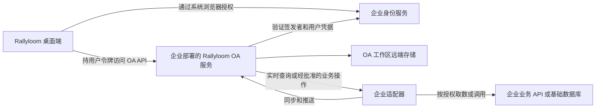

# Rallyloom 企业接入与授权方案

桌面端已实现服务检测、OIDC 授权、正式工作区绑定和独立 Demo。接入企业需部署下文的接口。正式模式当前提供远端办公室、房间看板与按权限开放的只读成员目录。交流室、任务看板、文档中心和通知中心仍可在 Demo 体验。事件信封和承接接口继续遵循 [接入规范](integration-spec.md)。

## 1. 企业怎么接入

企业在自己管理的环境里部署 Rallyloom OA 服务，并在自己的代码库里实现一层**企业适配器**。适配器可以是现有后端的模块，也可以是独立服务。它复用已有的业务 API，或按授权读取企业数据库的指定视图，把内部字段与规则转换成 Rallyloom 的数据契约。桌面端绑定企业 OA 服务地址。



| 企业现状 | 企业侧需要做的事 |
|---|---|
| 已有业务 API 和身份服务 | 注册 Rallyloom 登录客户端，配置身份映射，并给现有 API 增加字段转换或事件推送 |
| 有业务 API，缺少适用的企业登录 | 部署或接入身份服务，将已有人员目录和登录身份关联，再完成接口适配 |
| 目前只有远端数据库 | 在企业环境部署适配器，用专用只读视图取数，并配置企业身份服务。由适配器暴露约定接口或发出事件 |

数据库连接配置和凭据由企业服务端持有。读取账号按环境、库和视图授予最小权限。业务更新优先复用企业已有的领域接口，让权限、校验、审批与审计继续在企业系统执行。企业决定部署位置、数据范围和谁有权启用集成。

## 2. 三类授权各自生效

| 授权 | 谁批准 | 生效范围 | 怎么撤销 |
|---|---|---|---|
| 企业接入授权 | 企业部署管理员或其指定的集成管理员 | 指定环境的 OA 安装实例、工作区、身份服务和允许接入的数据源。读写能力分别启用 | 停用安装实例、工作区或数据源。OA 服务从下一次请求起拒绝相应访问 |
| 员工访问授权 | 企业身份服务认证，OA 服务依据工作区成员关系授权 | 当前员工在特定工作区的模块和操作，例如查看任务、调整工位、管理成员 | 移除成员、变更角色或撤销会话。OA 服务重新判定权限，仍有效的旧令牌也受当前权限约束 |
| 适配器服务授权 | 企业集成管理员 | 绑定一个工作区与一个 `source_id`，只允许已批准的事件或 API 操作 | 吊销或轮换承接令牌，停用适配器授权。读取企业数据库的服务账号单独轮换 |

接入授权属于企业自己的部署。首次部署由部署人员通过服务端配置或受控管理流程指定初始管理员。员工首次连接时依照已有成员权限或已批准的入队策略进入。各企业自行掌握授权与撤销记录。

## 3. 绑定与登录

1. **准备正式环境。** 企业配置服务地址、工作区、身份服务、已登记的适配器和模块能力。服务端从部署配置确定 `installation_id`，从工作区记录确定 `workspace_id`。两个标识在更名时保留。
2. **检测服务。** 用户从「绑定公司工作区」输入企业提供的 HTTPS 地址。桌面端读取最小发现信息，检查服务身份、接口版本与登录配置。界面显示公司和工作区名称，由用户核对企业提供的地址。发现成功表示服务可以进入授权阶段。
3. **员工完成授权。** 桌面端打开系统浏览器走 OIDC Authorization Code + PKCE（`S256`），使用身份服务登记的原生客户端和精确匹配的回调 URI。校验此次请求的 `state`、OIDC 的 `nonce` 和预期签发者。访问令牌用于调用预期的 OA API，ID Token 只用于验证身份。桌面端使用公开的 `client_id`。 [原生应用 OAuth](https://www.rfc-editor.org/rfc/rfc8252.html) · [OpenID Connect Core](https://openid.net/specs/openid-connect-core-1_0.html)
4. **验证后保存绑定。** 用当前用户的令牌读取 `GET /api/v1/workspace/bootstrap`，校验返回的工作区、当前成员、权限、布局与模块能力。全部通过后原子地保存绑定并进入工作区。测试新连接时保留上一份已验证配置。
5. **后续启动与退出。** 桌面端记住已验证的服务地址、实例和工作区。当前进程内可继续使用有效会话。令牌过期、退出登录或重启应用后，需要通过企业身份服务重新授权。解除本机绑定会一并清除内存会话和本机连接记录。服务端停用工作区或成员时，界面显示明确状态并提供重新授权、重新绑定或进入 Demo。

### 接口草案

`GET /api/v1/workspace/discovery` 公开最小元数据。`issuer` 对应 OIDC 发现配置。身份服务为 `client_id` 注册无客户端密钥的原生客户端，启用 Authorization Code 和 `S256`，精确注册 `rallyloom://callback`，并接受 `resource` 作为 OA API 的资源指示符。发现接口响应示例如下。 [OAuth 资源指示符](https://www.rfc-editor.org/rfc/rfc8707.html)

```json
{
  "installation_id": "enterprise-oa-prod",
  "workspace_id": "operations",
  "display_name": "示例企业运营工作区",
  "api_version": "v1",
  "authorization": {
    "issuer": "https://identity.example.com",
    "client_id": "rallyloom-desktop",
    "resource": "https://oa.example.com"
  }
}
```

发现接口只返回实例与登录所需信息。正式数据由受保护的接口提供。桌面端只向企业确认的 HTTPS 来源发送该资源的令牌，跨域重定向不能携带令牌。企业应通过可信的部署渠道提供服务地址与预期身份服务。已绑定的实例、工作区或签发者变化时，按重新绑定流程验证。多工作区部署时，可用工作区路径或可验证的会话绑定指定工作区，服务端在每次请求中确认用户有权操作对应工作区。 [OAuth 安全最佳实践](https://www.rfc-editor.org/rfc/rfc9700.html)

`GET /api/v1/workspace/bootstrap` 使用 `Authorization: Bearer <access_token>`。响应顶层包含 `installation_id`、`workspace_id`、`member_id`、`tenant`、`permissions`、`team`、`policy`、`layout`、`dataSlots`。`tenant` 为 `{ "id": "<workspace_id>", "name": "<display_name>" }`——工作区就是租户（一家公司一个工作区，多租户边界见 [接入规范](integration-spec.md) §10），客户端不可选择。工作区 ID 与发现接口一致。`team` 包含 `member_id` 对应的记录，按当前账号权限裁剪后返回。`office.view` 允许进入办公室，`team.view` 额外开放只读目录。`layout` 使用当前房间模板、画布尺寸和工位编排，房间 `template` 使用客户端已注册的 ID。项目中的 [工作区数据类型](../src/lib/store/types.ts) 和 [成员类型](../src/lib/identity/types.ts) 提供字段定义。

房间看板配置为 `dataSlots[roomId] = { kind: "external-api", name, url }`。`url` 指向与工作区服务同源的 HTTPS 接口，由桌面主进程持员工令牌请求。服务端每次验证访问权限，返回 `{ "rows": [{ "label": "待发货订单", "value": "128" }] }`。无看板时返回 `dataSlots: {}`。

连接界面区分地址不可达、证书或接口版本不符、需要重新授权、成员无权访问和工作区已停用。服务端用 `401` 表示凭据缺失或失效，用 `403` 表示身份有效但访问被拒。现有事件的 `schema_version` 单独演进。

## 4. 服务端怎样执行权限

- **身份关联。** 服务端从已验证的凭据取得 `issuer + sub`，用它定位登录身份。目录成员仍按 `source_id + external_user_id` 去重，并由服务端在工作区内建立两者的显式关联。首次入队遵循企业启用的同步策略，用户组来自经验证的身份服务或获授权的目录源。邮件和显示名用于展示，账号合并需要可信的身份映射。
- **逐请求授权。** OA 服务验证访问令牌的签发者、受众、有效期及签名，或走适用的服务端令牌查询，再查当前工作区成员关系、角色与操作权限，并验证目标记录属于该工作区。客户端依据权限调整界面，实际放行由服务端决定。
- **组织与角色。** 目录事件提供成员和外部组。企业提供方定义角色名称和权限，按 [正式工作区契约](workspace-provider.md) 返回会话能力和逐成员操作，可选择开放角色配置表单。当前成员状态、显式撤销及工作区停用优先于历史角色映射与客户端缓存。
- **推送与员工会话。** 适配器使用现有 `/ingest` 承接令牌。接收服务端按令牌绑定的工作区、`source_id` 和允许的事件类型校验载荷。桌面员工令牌用于用户接口。企业若采用 OAuth Client Credentials，适用对象是能保管凭据的服务端客户端。 [OAuth 2.0 客户端凭据](https://www.rfc-editor.org/rfc/rfc6749.html#section-4.4)
- **凭据与审计。** 桌面端优先让访问令牌留在会话内存。允许跨启动恢复会话时，使用操作系统保护的凭据存储，并按身份服务能力轮换和撤销。接入注册与撤销、角色变更、业务写入和关键拒绝应能按工作区、操作者、资源和时间追溯。日志记录事件标识与授权结果，凭据留在专用保管渠道。

### 可选的跨启动会话恢复

希望启用「记住登录」的提供方在 OIDC discovery 声明 `grant_types_supported: [..., "refresh_token"]` 与 `scopes_supported: [..., "offline_access"]`，并在支持时声明 `revocation_endpoint`。只有工作站安全存储可用且提供方同时声明两项能力，客户端才会请求 `offline_access`。

- 提供方在成功的授权码兑换中返回 `refresh_token`。客户端仅将刷新凭据和已验证绑定加密写入操作系统保护的本地文件，访问令牌留在主进程内存。
- 重启后，客户端向已验证的 `token_endpoint` 提交 `grant_type=refresh_token`、`refresh_token`、`client_id`、`resource`，然后重新读取 bootstrap。提供方应轮换刷新令牌、限制有效期、检查账号和工作区状态，并撤销被重放或显式退出的会话。
- 明确拒绝已失效会话时返回 `400` 与 `error=invalid_grant`。网络暂不可用应允许客户端保留凭据并重试。退出登录时客户端清除本地凭据，并在提供方声明时向撤销端点提交刷新令牌。

## 5. 数据接入与企业定制

企业适配器交付字段映射表，为每项数据登记**拥有方、企业字段、Rallyloom 字段、读取范围、更新方向和稳定标识**。首轮可选少量数据验证映射，再启用更多模块。

| 能力 | 接入方式 | 可定制内容 |
|---|---|---|
| 人员、组、成员关系 | 使用既有的 `person.upsert`、`group.upsert` 和 `members.reconcile` 等事件 | 组与角色映射、成员关联、部门或岗位等展示属性 |
| 任务、动态、公告、文档 | 复用现有事件契约和稳定外部 ID。实时查询由受保护的 OA 接口或服务端适配器完成 | 任务展示列、外部状态映射、文档目录、公告级别 |
| 办公室和运营看板 | 房间、工位和看板配置保存在 OA 工作区。企业指标由专用只读接口提供 | 房间模板、工位布局、指标来源和刷新配置 |
| 聊天和附件 | 接企业部署的 OA 协作后端，按工作区、频道和参与者校验读写 | 频道命名、保留策略、附件服务配置 |
| 更新企业业务数据 | 单独开启写入能力，由 OA 服务调用企业已批准的领域接口 | 动作映射、审批触发、写入方与回写规则 |

布局、字段与规则优先通过工作区配置调整。复杂转换放在企业适配器代码内。新增跨系统动作时，约定数据主责方、用户权限与重试幂等后再启用写入。正式工作区展示服务端已声明且当前员工已获授权的能力。

例如电商企业想把「今日成交额」和「待发货订单」挂到办公室，可以让适配器只读取 ERP 的运营汇总视图，由 OA API 按运营权限返回看板所需的汇总字段。后续如果要在 OA 里确认发货，再单独对接 ERP 的发货接口，沿用原来的校验和审计。

## 6. Demo 与正式环境

启动页和工作区菜单一直提供「进入演示」。正式环境未绑定、连接故障或登录过期时都可进入 Demo。Demo 显示明确的模式标记，使用独立的本机种子、消息、附件和调试状态。正式业务读取与写入均走已授权的远端服务。切换环境时取消旧请求和订阅，按模式、实例、工作区和用户隔离会话、缓存及附件路径。返回正式工作区时重新检查授权状态。

## 7. 首次交付和验收

1. **先接身份和工作区。** 企业交付 OA 服务地址、部署与工作区标识、身份映射、初始管理员配置和字段映射表。验证发现、授权、初始化、退出与重新绑定。用过期凭据、无权限账号和其他工作区的账号分别验收。
2. **再接一个业务模块。** 优先验证一个只读场景或一个源系统推送。演示稳定 ID、幂等重试、轮换承接令牌和全量对账。采用数据库适配器时核对专用视图、最小权限账号和服务端密钥保管。
3. **验收撤销与隔离。** 停用工作区、移除成员、撤销会话或吊销适配器令牌后，检查对应凭据的下一次请求被拒。测试跨工作区请求、使用员工令牌推送、使用适配器令牌读取正式页面、载荷冒用其他 `source_id` 等情形。验证绑定失败保留原配置，以及正式环境与 Demo 双向切换后各自数据独立。
4. **逐模块扩充。** 根据企业需要接通聊天、任务、文档、公告及跨系统动作。先在测试工作区验证接口兼容、数据归属和失败恢复，再启用正式权限。
